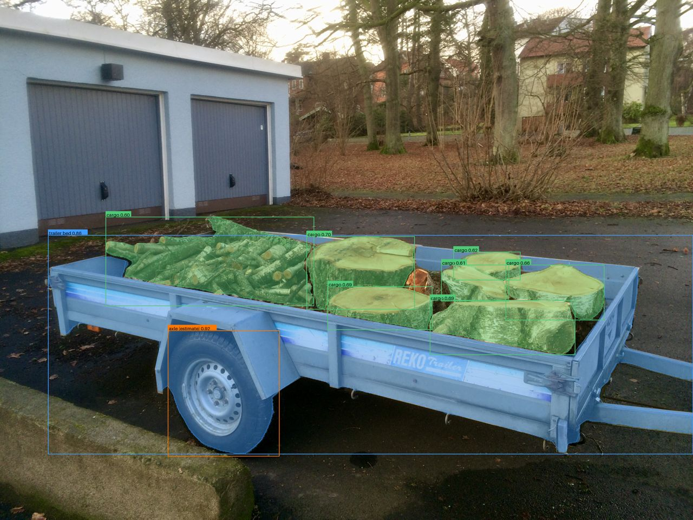
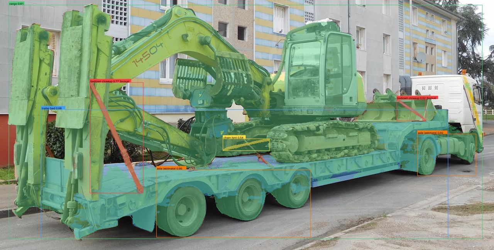
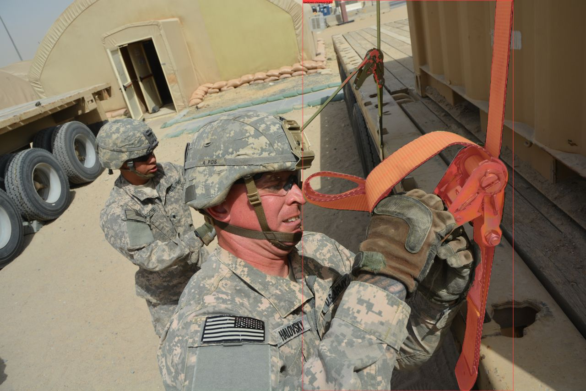

# LoadMaster

LoadMaster checks a loaded trailer against the federal cargo
securement rules (49 CFR Part 393, Subpart I) and tells the hauler, in
plain words, what to fix before the trailer rolls.

It is a rules system, not a picture describer. SAM 3.1 (Meta Model API)
segments the load, the trailer bed, the wheels and axles, and the
tie-downs, and turns those masks into measurements: tie-down count and
coverage, rear overhang, load balance against the axle position, tarp
coverage. A deterministic rules engine applies the actual securement
rules to those measurements and returns PASS, CHECK THIS, or COULD
NOT TELL for every check, with the rule citation and one specific fix
for every problem. Muse Spark (Meta Model API) turns those verdicts
into a plain-words report and independently cross-checks photos; when
the two models disagree, the verdict drops to CHECK THIS. A
fix-and-recheck loop lets the hauler correct what the camera missed
and see exactly which verdicts changed.

## Try it live

- **The working app:** https://littlestjames82-sys--loadmaster-fastapi-app.us-east.modal.run
  Open it on a phone, take or choose a photo of a loaded trailer, and
  get the full check back. The first run after idle can take a minute
  or two while a container starts; later runs are much faster.
- **Sample runs:** https://littlestjames82-sys--loadmaster-fastapi-app.us-east.modal.run/gallery
  Three real pipeline runs (firewood side view, excavator lowboy rear
  view, ratchet-strap anchor close-up), captured from the app itself.

Real output, straight from those runs (detections outlined on the
photo, verdicts one tap away in the app):

## Why it matters, in numbers

- Cargo securement was the official vehicle focus area of CVSA
  Roadcheck 2026, and it still ranked #4 among vehicle
  out-of-service violations: 1,724 violations, 12.4 percent of the
  vehicle total, in three days of inspections (CVSA, 2026 results).
- FMCSA's 2025 full-year numbers (via CVSA) count 18,108 violations
  for cargo not secured to prevent leaking, spilling, blowing, or
  falling, plus 16,054 for unsecured vehicle components and dunnage.
- The AAA Foundation's 2026 update counts road debris, most
  commonly unsecured cargo and fallen vehicle parts, in more than
  319,000 crashes with more than 32,000 injuries and 433 deaths
  across 2018 to 2023.

The rules exist and are enforced. What is missing is a way for the
person tying the load down to check it before an inspector, or the
road, does it for them.

## For the judges (where the evidence lives)

- **Impact (30%):** the numbers above; a tool aimed at the
  independents who have no safety department (91.1 percent of US
  carriers run 10 trucks or fewer, ATA Trends 2026); a Spanish
  report option and a listen-aloud report for the workforce that
  actually hauls (Hispanic drivers are 25.7 percent of US truck
  drivers, EPI/CPS 2025; 28 percent of Hispanic adults are
  smartphone-dependent for internet, Pew 2025).
- **Use of Meta AI Tooling (25%):** SAM 3.1 does the geometry
  (segmentation, calibrated measurement), Muse Spark does two
  distinct jobs: an independent second read of the photo that can
  demote verdicts, and the plain-words report written strictly
  from the engine's verdicts. Both models, two roles each, one
  deterministic referee between them.
- **Demo (25%):** the live app link above works right now; the
  gallery shows real runs with no upload; the 3-minute video shows
  a failing load, the fix, and the recheck flipping it to PASS.
- **Technical Depth and Execution (20%):**
  docs/ARCHITECTURE.md (design decisions, including the measured
  reason straps are counted from close-ups plus tap marks, never
  from full-frame guesses), 144 automated tests, examples/output/
  (real pipeline artifacts), BUILD_LOG.md (the whole build, in
  the open).

## How it compares

The closest product, CargoPro, is a per-driver checklist app: it
asks the driver to count the tie-downs, does working load limit
math on the numbers typed in, and attaches photos as unanalyzed
evidence. Telematics platforms (Samsara, Motive) digitize
inspection forms at fleet prices with hardware. The incumbent for
most independents is a plastic sliding calculator. LoadMaster is
the one that looks at the photo: it sees the load, measures it,
applies the actual rules, cites them, and has a second model check
the first one's work.

## What is built

- SAM 3.1 pipeline: prompt packs keyed to trailer type, load type,
  and photo role; parallel calls with retry; mask decoding; an
  editable detection model designed for tap-to-correct; annotated
  overlay renders.
- Calibrated measurements: bed-length calibration turns pixels into
  inches (rear overhang, load centroid vs axle position with an
  uncertainty range, tarp coverage, tie-down coverage gaps). The
  layer refuses to guess a scale it cannot support.
- Deterministic 49 CFR 393 rules engine: the 8 checks below, each
  verdict linked to its evidence (mask region, measurement, rule
  citation) and a minimum fix, risk-ranked.
- Dual-model cross-check: Muse Spark reads the photo independently;
  disagreement demotes a verdict to CHECK THIS, never upgrades one.
- Muse Spark report: a short, plain-words, fix-first summary written
  strictly from the verdicts (a template fallback covers any model
  failure). Available in English or Spanish, with a listen-aloud
  readout in the app.
- Tap-to-correct + instant recheck with a visible before/after delta;
  guided capture with photo quality gates; a printable one-page
  report card; a judges' sample gallery of real runs.
- Multi-photo runs: side + rear + close-up photos of the same load
  are analyzed together and judged as one set, the way the rules
  engine was designed to see a load. The side view carries the
  measurements, the rear view judges lights and plate, close-ups
  carry the tie-down count. Installable as a phone app (PWA).
- Scoring harness (tools/score_runs.py): runs photo sets through the same path the app uses and diffs every verdict against expected statuses, built for the staged test set where the ground truth is known.
- Measured on itself: across the 11 full runs captured during
  development (68 rule verdicts), the second opinion's independent
  answers are recorded in the evidence of 19 verdicts, and in the
  live close-up run its strap count disagreed with SAM's (2 vs 1)
  and moved the edge-protection verdict on its read alone.
- 144 automated tests (pytest), all passing. Architecture and design decisions: docs/ARCHITECTURE.md.
- Hosted as a FastAPI app on Modal, deployed by GitHub Actions on
  every push to this repository.

Built by Ryan Cotten (Ghost Developer Studio, Oakdale, Tennessee) for
the Meta Global AI Developer Hackathon, Indie Developer track, theme:
Build for Your World. Ryan hauls firewood, equipment, and trailers in
East Tennessee. This is a real problem from his own work.

## Honesty line

A photo check can count visible tie-downs and flag placement. It cannot
verify strap tension, actual working load limit ratings, or load
weight. LoadMaster says so in every report, and any check that depends
on something a photo cannot show comes back COULD NOT TELL, with the
reason named, never a guess.

## The checks (49 CFR 393)

1. Tie-down count by load length (393.110)
2. Tie-down strength: aggregate working load limit at least 50 percent
   of load weight (393.106, 393.108); photo-limited, see honesty line
3. Heavy equipment, 10,000 lb or more: at least 4 tie-downs, accessories
   lowered and secured (393.130)
4. Forward blocking against sliding under braking
5. Edge protection where straps or chains cross sharp edges
6. Overhang, and lights or plate obscured
7. Tarp coverage of loose material
8. Weight placement: centered, heavier end forward of the axles
   (reported as a visual estimate only)

## Built during the hackathon (Oct 26 - Nov 4, 2026)

Everything in this repository was created inside the hackathon window.
Pre-window work was research only: a written spec grounded in 49 CFR
393, with no code and no repository.

- Oct 26: repository created; SAM 3.1 and Muse Spark access proven on
  the Meta Model API (first SAM call: one trailer mask, 0.863
  confidence, on a development photo).
- Oct 26 (Day 1): the SAM pipeline is built: prompt packs keyed to
  trailer type, load type, and photo role; mask decoding; an editable
  detection model built for tap-to-correct; and annotated overlay
  renders. Proven on development photos, outputs in examples/output/.
  Run it with `python -m loadmaster.pipeline --photo PHOTO
  --trailer-type utility --load-type firewood --role side --out-dir
  examples/output` (dependencies in requirements.txt).
- Oct 26 (Day 2): the measurement layer: calibration, overhang,
  centroid vs axle as a labeled visual estimate, tarp coverage,
  tie-down gaps, each with honest refusal paths.
- Oct 26 (Day 3): the deterministic rules engine (all 8 checks) and
  the Muse Spark cross-check, then the working app itself: FastAPI
  service + mobile web UI, deployed live on Modal the same day.
- Oct 26 (Day 4 build session): Muse Spark report layer, recheck
  delta, guided capture + quality gates, printable report card, and
  the judges' sample gallery. First real end-to-end use on a phone:
  a 19-bale hay load, every bale found, verdicts matching the photo.

Build progress is logged in BUILD_LOG.md in the order it happened.

## Libraries and services used (not claimed as new work)

- Meta Model API: SAM 3.1 (segmentation) and Muse Spark 1.3 (report
  reasoning), accessed with an API key that is never stored in this
  repository.
- meta-sam-parser (Meta's SAM output parser) for mask decoding; the
  build log records the Day 1 route decision.
- Pillow for image handling and overlay rendering.

## License

MIT. See LICENSE.
